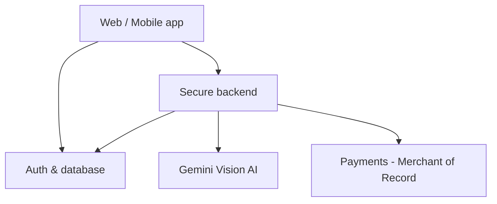

# ✨ GlowAI

**AI photo enhancement and studio relighting for creators.**
Studio-quality portraits in one tap, right in the browser. Built by one founder.

🌐 [glowai.dev](https://www.glowai.dev) · ✉️ [hello@glowai.dev](mailto:hello@glowai.dev) · 🔒 Invite-only beta · Source code is private, available to investors under NDA

---

## The problem

Creators spend hours (or hundreds of dollars) on lighting, retouching and reformatting every photo for every platform. Good lighting should be a toggle, not a studio day.

## The product

GlowAI is a creator-first photo enhancement platform:

- **Studio relighting**: cinematic highlights, soft bloom and natural skin that keep texture and identity.
- **1-tap AI remaster**: portrait enhancement with studio lighting, clean backgrounds and color grading, powered by Google Gemini Vision.
- **Creator critique**: instant feedback on lighting, composition and the best crop for Instagram, Stories/TikTok and YouTube.
- **Instant, private editing**: sliders render on the user's own device, so photos only go to the cloud when AI remastering is requested.
- **Works everywhere**: web app (PWA) today, iOS and Android via native wrappers.

## How it fits together

## Tech stack

| Layer | Technology |
|---|---|
| Frontend | React, TypeScript, Vite, Tailwind |
| Rendering | Browser-native Canvas |
| AI | Google Gemini Vision |
| Auth and data | Supabase (row-level security) |
| Backend | Node/Express, edge functions |
| Billing | Lemon Squeezy (Merchant of Record, handles global tax) |
| Mobile | Capacitor (iOS and Android) |
| Infrastructure | Docker, Nginx, Cloudflare |

## Status and roadmap

- [x] Core editor and relighting engine
- [x] Auth and database
- [x] Invite-only beta (password-protected, testers onboarded)
- [ ] Open beta
- [ ] Payments and credits go live
- [ ] Public launch and Product Hunt
- [ ] Founding-member presale
- [ ] iOS and Android store releases

## Business model

Subscriptions (monthly and annual creator and studio tiers) plus credit packs for AI remastering. Web checkout works across all platforms.

## Contact

Founder: Niko Plagakis · [hello@glowai.dev](mailto:hello@glowai.dev) · [glowai.dev](https://glowai.dev)
For a demo, beta access, a technical walkthrough or code access, email hello@glowai.dev.

© 2026 GlowAI. All rights reserved.
